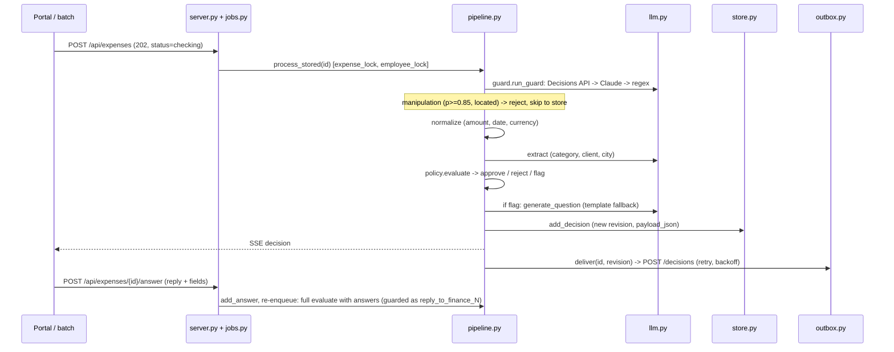

# Architecture

Generated by `/arch`; describes only what exists in code.

## Overview
Expenses arrive from a batch file (`batch.py`) or the React portal, and both go through `pipeline.process`.
Each one is guarded, normalised, has facts extracted by an LLM, and is decided by a pure policy engine; flags also get an LLM-drafted question.
Every decision is an append-only revision. It is delivered downstream through a retrying outbox and pushed to the UI over SSE, and a follow-up answer triggers a full re-decision.

## Components
| Module | Responsibility | File |
|---|---|---|
| Guard | schema whitelist and lengths, sanitising, manipulation screen with reject/suspect bands | app/guard.py |
| Normalize | parses USD amounts (strict format) and ISO/US dates; flags non-USD symbols | app/normalize.py |
| LLM | Decisions API screen, Claude screen, extraction, questions; tagged input, typed output | app/llm.py, app/prompts/ |
| Policy | pure rules: caps, weekend, client, receipt, codes, split, duplicate, >$1k, future/stale date, placeholders, multi-night | app/policy.py |
| Pipeline | `evaluate` (no side effects) + process/process_stored, locks, human override, failure flag | app/pipeline.py |
| Jobs | background decision workers, per-id coalescing, startup recovery | app/jobs.py |
| Outbox / poster | atomic claim, backoff retry, idempotency key, supersede; Finance retry | app/outbox.py, app/poster.py |
| Store | SQLite (WAL), atomic batch insert, filtered/paged queries, stats | app/store.py |
| Server | FastAPI REST + SSE, idempotency keys, CSV export, serves frontend/dist | app/server.py |
| UI | React SPA: /employee/*, /finance/* | frontend/ |
| Batch / eval | batch run; scoring on labelled + mock data | batch.py, eval.py |

## Decision flow

## State & data
- `expenses`: latest raw JSON, normalised view, `answers_json`, `version`, status. `expense_versions`: every submitted version (append-only, ADR 0007).
- `decisions`: one row per evaluation (`revision`, `expense_version`, `decided_by`), `payload_json` = the exact body POSTed, plus delivery state (pending/sent/failed/dead/superseded).
- `followups`: question, answer, open/answered/superseded. `idempotency`: per-endpoint keys. POSTed: id, employee, decision, reasons, question, amount, category, client, revision, decided_by, policy/prompt versions, `decision_key`.

## Safety boundaries
| AGENTS.md rule | Enforced at | Test |
|---|---|---|
| Code decides; policy is pure | app/policy.py:15-18 (only dt, re, config); app/pipeline.py:121 | tests/test_policy.py; purity itself: **GAP** |
| Guard first, on expenses and replies | app/pipeline.py:76 (replies at :73); app/guard.py:109 | tests/test_guard.py:49,59-70; tests/test_adversarial.py:24 |
| Manipulation -> reject | app/pipeline.py:82 | tests/test_adversarial.py:19; tests/test_server.py:118 |
| Fail closed | app/pipeline.py:139; app/pipeline.py:268 (`check_failed`) | tests/test_adversarial.py:52,59; tests/test_races.py:94 |
| Untrusted text in tags, structured output | app/llm.py:66 `_wrap`; :49 json_schema; :93 typed answers | **GAP** (no prompt-shape test) |
| Batch and portal share one path; stored == POSTed | batch.py:26; app/outbox.py:35 reads `payload_json` | tests/test_server.py:108; shared path: **GAP** |
| Answer adds data, never sets decision | app/server.py:381; app/pipeline.py:71 (ALLOWED_FIELDS), :132 (dup) | tests/test_adversarial.py:29; tests/test_races.py:84 |
| Human decision final per version | app/pipeline.py:219,229,284 (Stale -> 409) | tests/test_races.py:46,54; tests/test_server.py:173,189 |
| No keys in logs or code | keys only from env (app/config.py); `.env` in .gitignore | **GAP** |

## LLM providers & fallback
- Guard: OpenAI Decisions API (`gpt-6-luna`, calibrated probability + field choice) -> Claude screen -> regex backstop (always run when no hit).
  Bands: p >= 0.85 and located -> reject; 0.5-0.85 or unlocated -> `possible_manipulation` flag.
- Extraction and questions: Claude (`LLM_MODEL`, default `claude-haiku-5-5`) with server-side fallback; questions fall back to a template.

## Failure modes
Guard/LLM down -> `guard_unavailable`/`llm_unavailable` flag; job crash -> `check_failed` flag (stored, POSTed).
Endpoint down -> 8 retries then `dead` (Finance can retry the latest). Restart -> `checking`/`error` re-queued, stale `sending` reset.

## Decisions
[0001 code decides](adr/0001-deterministic-policy-llm-at-edges.md) · [0002 guard](adr/0002-input-guard-decisions-api.md) · [0003 reject vs flag](adr/0003-reject-manipulation-flag-unknowns.md) · [0004 USD only](adr/0004-no-fx-table.md) · [0005 SQLite append-only](adr/0005-sqlite-append-only.md) · [0006 backstops](adr/0006-backstop-rules.md) · [0007 versions](adr/0007-expense-version-history.md); table in docs/DECISIONS.md.

## Planned
Auth/roles, receipt OCR, an approval-code service, per-person caps, an alcohol rule, frontend tests (Vitest). See FutureWork.md.
